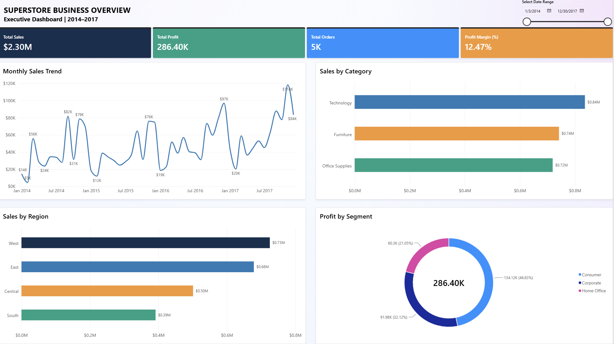
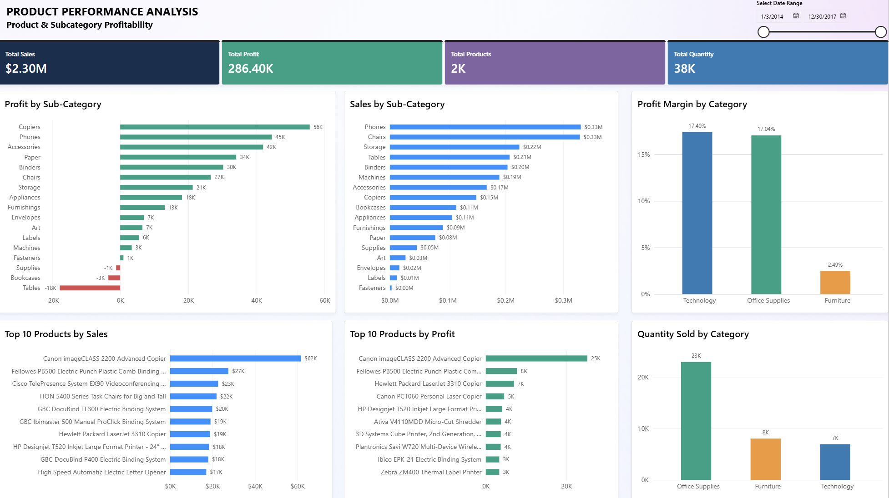
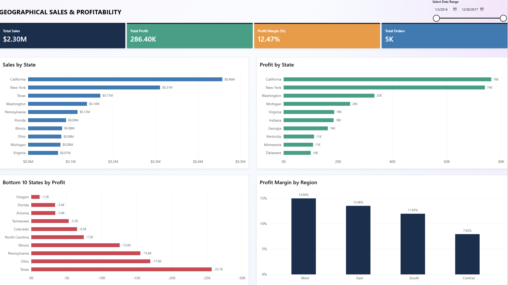
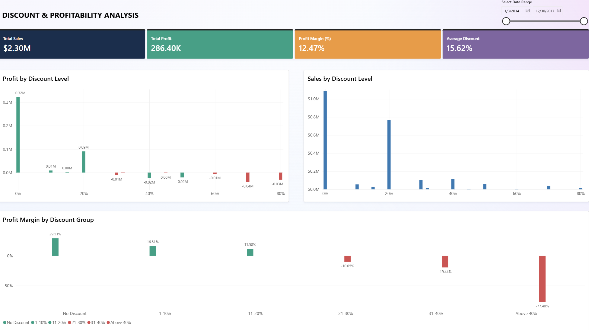
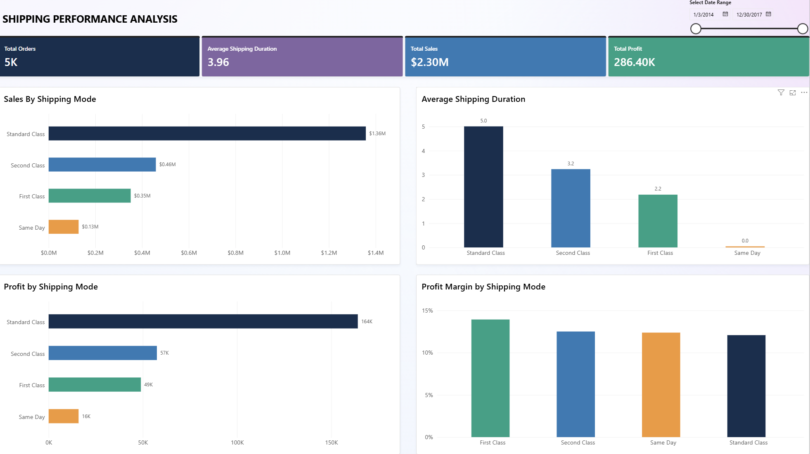

# Superstore Business Intelligence & Data Analytics Project

An end-to-end Business Intelligence and Data Analytics project using the Sample Superstore dataset. This project applies Python for data cleaning and exploratory data analysis (EDA), PostgreSQL for data validation and business analysis, and Power BI for interactive dashboard development.

The objective is to transform raw retail transaction data into meaningful business insights that support data-driven decision-making across sales, profitability, products, customers, geographical performance, discounts, and shipping operations.

---

## Table of Contents

1. [Project Overview](#1-project-overview)
2. [Business Objectives](#2-business-objectives)
3. [Dataset Description](#3-dataset-description)
4. [Tools & Technologies](#4-tools--technologies)
5. [Project Workflow](#5-project-workflow)
6. [Repository Structure](#6-repository-structure)
7. [Data Preparation & Exploratory Data Analysis](#7-data-preparation--exploratory-data-analysis)
8. [SQL Analysis](#8-sql-analysis)
9. [Power BI Dashboard](#9-power-bi-dashboard)
10. [Key Performance Indicators](#10-key-performance-indicators)
11. [Key Business Insights](#11-key-business-insights)
12. [Business Recommendations](#12-business-recommendations)
13. [How to Run This Project](#13-how-to-run-this-project)
14. [Analytical Considerations & Limitations](#14-analytical-considerations--limitations)
15. [Future Improvements](#15-future-improvements)
16. [Author](#16-author)

---

## 1. Project Overview

The Superstore Business Intelligence Project analyzes retail transaction data to evaluate business performance and identify opportunities for improvement.

The project follows an end-to-end analytics workflow:

- **Python:** Data understanding, data quality assessment, data cleaning, exploratory data analysis, and initial business insights.
- **PostgreSQL:** Structured data storage, data validation, and SQL-based business analysis.
- **Power BI:** Interactive dashboards, KPI monitoring, and business performance visualization.

The analysis focuses on six major business areas:

1. Executive Overview
2. Product Analysis
3. Customer Analysis
4. Geographical Analysis
5. Discount Analysis
6. Shipping Analysis

The final deliverable is an interactive Power BI dashboard supported by Python analysis, SQL queries, and business insight documentation.

## 2. Business Objectives

The main objectives of this project are:

- Evaluate overall sales and profitability performance.
- Identify the most profitable and underperforming product categories and sub-categories.
- Analyze customer purchasing behavior and customer segments.
- Identify geographical areas with strong and weak business performance.
- Understand the relationship between discount levels and profitability.
- Evaluate shipping methods based on sales, profit, and order processing duration.
- Translate analytical findings into actionable business recommendations.

### Key Business Questions

| Business Area | Key Questions |
|---|---|
| Overall Performance | How much revenue and profit does the business generate? |
| Sales Performance | Which categories and regions contribute the most sales? |
| Product Analysis | Which products generate the highest profit and which products generate losses? |
| Customer Analysis | Which customer segments contribute the most revenue and profit? |
| Geographical Analysis | Which states perform best and which states generate losses? |
| Discount Analysis | How do different discount levels relate to profitability? |
| Shipping Analysis | Which shipping modes have the highest sales, profit, and profit margin? |

## 3. Dataset Description

**Dataset:** Sample Superstore

**File:** `Sample - Superstore.csv`

The dataset contains retail transaction records with information about orders, customers, products, geographical locations, discounts, sales, profit, and shipping.

### Dataset Information

| Attribute | Description |
|---|---|
| Total Rows | 9,994 |
| Total Columns | 21 original columns |
| Processed Columns | 22 columns, including Shipping_Duration |
| Dataset Type | Retail transaction data |
| Data Granularity | Order-item / transaction-line level |

### Main Dataset Columns

| Column | Description |
|---|---|
| Row ID | Unique identifier for each transaction row |
| Order ID | Unique order identifier |
| Order Date | Date when the order was placed |
| Ship Date | Date when the order was shipped |
| Ship Mode | Shipping method |
| Customer ID | Unique customer identifier |
| Customer Name | Customer name |
| Segment | Customer segment |
| Country | Country |
| City | Customer city |
| State | Customer state |
| Postal Code | Postal code |
| Region | Geographical region |
| Product ID | Unique product identifier |
| Category | Product category |
| Sub-Category | Product sub-category |
| Product Name | Product name |
| Sales | Sales amount |
| Quantity | Number of items purchased |
| Discount | Discount applied |
| Profit | Profit or loss generated |

An additional column was created during data preparation:

| Column | Description |
|---|---|
| Shipping_Duration | Number of days between Order Date and Ship Date |

**Note:** Shipping_Duration measures the time between order placement and shipment dispatch. It does not represent the actual delivery time to the customer.

## 4. Tools & Technologies

| Tool | Purpose |
|---|---|
| Python | Data cleaning, preparation, and exploratory analysis |
| Pandas | Data manipulation and transformation |
| NumPy | Numerical operations |
| Matplotlib | Data visualization |
| Seaborn | Statistical visualization |
| Jupyter Notebook | Interactive Python development |
| PostgreSQL | Relational database management |
| DBeaver | SQL development and database management |
| SQL | Data validation and business analysis |
| Power BI Desktop | Interactive dashboard development |
| DAX | Measures and calculated columns |
| Git & GitHub | Version control and project documentation |

## 5. Project Workflow

The project was developed through the following stages:

### Stage 1 — Data Understanding

- Load the original Superstore dataset.
- Examine dataset dimensions and column names.
- Identify numerical and categorical variables.
- Review data types and statistical summaries.

### Stage 2 — Data Quality Assessment

- Check missing values.
- Identify duplicate records.
- Validate date fields.
- Check numerical values and business-related constraints.
- Examine negative profit records.

### Stage 3 — Data Cleaning & Preparation

- Convert date columns into appropriate date formats.
- Validate numerical data types.
- Check data consistency.
- Create the Shipping_Duration feature.
- Export the processed dataset for subsequent analysis.

### Stage 4 — Exploratory Data Analysis (EDA)

- Analyze overall business performance.
- Examine sales and profitability by category.
- Analyze product and sub-category performance.
- Explore customer segments and purchasing behavior.
- Evaluate geographical performance.
- Investigate discount and shipping patterns.

### Stage 5 — PostgreSQL & SQL Analysis

- Create the project database and schema.
- Import the cleaned dataset.
- Validate data quality using SQL.
- Perform business analysis using SQL queries.
- Extract findings for business reporting.

### Stage 6 — Power BI Dashboard Development

- Connect Power BI to PostgreSQL.
- Create DAX measures.
- Design KPI cards.
- Build interactive charts and visualizations.
- Add date slicers and interactive filtering.
- Organize the dashboard into six analytical pages.

### Stage 7 — Business Insights & Recommendations

- Consolidate findings from Python, SQL, and Power BI.
- Identify business strengths and weaknesses.
- Develop practical recommendations based on analytical results.

## 6. Repository Structure

The repository is organized into the following structure:

```text
superstore-bi-analyst/
│
├── data/
│   ├── Sample - Superstore.csv
│   └── superstore_cleaned.csv
│       
├── notebooks/
│   └── superstore_eda.ipynb
│
├── sql/
│   ├── 01_create_database.sql
│   ├── 02_data_quality_validation.sql
│   ├── 03_overall_business_performance.sql
│   ├── 04_sales_and_profitability_analysis.sql
│   ├── 05_product_analysis.sql
│   ├── 06_customer_analysis.sql
│   ├── 07_geographical_analysis.sql
│   ├── 08_discount_analysis.sql
│   ├── 09_shipping_analysis.sql
│   └── 10_business_insights.sql
│
├── powerbi/
│   ├── superstore_dashboard.pbix
│   └── screenshots/
│       ├── executive_overview.png
│       ├── product_analysis.png
│       ├── customer_analysis.png
│       ├── geographical_analysis.png
│       ├── discount_analysis.png
│       └── shipping_analysis.png
│
├── reports/
│   ├── business_insights.md
│   └── recommendations.md
│
└── README.md
```

## 7. Data Preparation & Exploratory Data Analysis

Data preparation and EDA were performed using Python in Jupyter Notebook.

**Notebook:** `notebooks/superstore_eda.ipynb`

### Analysis Sections

| Section | Description |
|---|---|
| Import Libraries | Import Python libraries |
| Load Dataset | Read the original CSV dataset |
| Data Understanding | Examine dataset structure and data types |
| Data Quality Assessment | Check missing values, duplicates, and invalid records |
| Data Cleaning | Prepare and validate the dataset |
| Exploratory Data Analysis | Explore sales, profit, products, customers, and other dimensions |
| Business Insights | Identify important business findings |
| Conclusion | Summarize the analysis |

### Data Quality Results

| Validation | Result |
|---|---:|
| Total Records | 9,994 |
| Total Original Columns | 21 |
| Missing Values | 0 |
| Full Duplicate Rows | 0 |
| Unique Row ID | 9,994 |
| Invalid Date Records | 0 |
| Invalid Sales Records | 0 |
| Invalid Quantity Records | 0 |
| Invalid Discount Records | 0 |

Negative profit values were retained because they represent actual business losses rather than invalid records.

### Feature Engineering

A new feature named `Shipping_Duration` was created:

```python
df["Shipping_Duration"] = (
    df["Ship Date"] - df["Order Date"]
).dt.days
```

This feature measures the number of days between order placement and shipment dispatch.

## 8. SQL Analysis

PostgreSQL was used to store and analyze the processed Superstore dataset.

### Database Configuration

| Component | Name |
|---|---|
| Database | `superstore_bi` |
| Schema | `staging` |
| Table | `stg_superstore` |
| Database Tool | DBeaver |
| Database Engine | PostgreSQL |

### SQL Analysis Files

| File | Analysis |
|---|---|
| 01_create_database.sql | Create the project database |
| 02_create_schema_and_tables.sql | Create schema and staging table |
| 03_data_quality_validation.sql | Validate data quality |
| 04_overall_business_performance.sql | Calculate overall business KPIs |
| 05_sales_and_profitability_analysis.sql | Analyze sales and profitability |
| 06_product_analysis.sql | Analyze products and sub-categories |
| 07_customer_analysis.sql | Analyze customers and segments |
| 08_geographical_analysis.sql | Analyze state and regional performance |
| 09_discount_analysis.sql | Evaluate discount levels and profitability |
| 10_shipping_analysis.sql | Analyze shipping performance |
| 11_business_insights.sql | Consolidate business insights |

### SQL Data Validation

The imported table contains:

- 9,994 transaction rows.
- 9,994 unique Row ID values.
- No missing values in the validated important fields.
- No invalid date records.
- No invalid sales, quantity, or discount values.

### Overall Business Performance

The SQL analysis produced the following results:

| Metric | Value |
|---|---:|
| Total Sales | $2,297,201.07 |
| Total Profit | $286,397.79 |
| Total Orders | 5,009 |
| Total Customers | 793 |
| Total Products | 1,862 |
| Total Quantity | 37,873 |
| Profit Margin | 12.47% |
| Average Order Value | $458.61 |

## 9. Power BI Dashboard

The Power BI dashboard consists of six pages designed to provide a comprehensive view of Superstore business performance.

Each page includes relevant KPIs, charts, and interactive filtering to support business analysis.

### Page 1 — Executive Overview

**Objective:** Provide a high-level overview of overall business performance.

Main KPIs:
- Total Sales
- Total Profit
- Total Orders
- Profit Margin

Visualizations:
- Monthly Sales Trend
- Sales by Category
- Sales by Region
- Profit by Segment

Key focus:
- Monitor overall business performance.
- Identify the strongest product category.
- Compare geographical sales performance.
- Understand profit contributions from customer segments.

**Dashboard Screenshot:**



### Page 2 — Product Analysis

**Objective:** Evaluate product performance and identify profitable and underperforming products.

Main KPIs:
- Total Sales
- Total Profit
- Total Products
- Total Quantity

Visualizations:
- Profit by Sub-Category
- Sales by Sub-Category
- Profit Margin by Category
- Top 10 Products by Sales
- Top 10 Products by Profit
- Quantity Sold by Category

Key focus:
- Identify products with the highest sales.
- Identify products generating the highest profit.
- Detect loss-making sub-categories.
- Evaluate category-level profitability.

**Dashboard Screenshot:**



### Page 3 — Customer Analysis

**Objective:** Understand customer purchasing behavior, segment contribution, and customer profitability.

Main KPIs:
- Total Customers
- Total Orders
- Revenue per Customer
- Average Orders per Customer

Visualizations:
- Customer Type Distribution
- Top 10 Customers by Revenue
- Top 10 Customers by Profit
- Customer Segment Analysis

Key focus:
- Understand customer purchasing frequency.
- Compare repeat and one-time customers.
- Identify high-value customers.
- Evaluate revenue and profit contribution by customer segment.

**Dashboard Screenshot:**


### Page 4 — Geographical Analysis

**Objective:** Evaluate sales and profitability across geographical locations.

Main KPIs:
- Total Sales
- Total Profit
- Profit Margin
- Total Orders

Visualizations:
- Top 10 States by Sales
- Top 10 States by Profit
- Bottom 10 States by Profit
- Profit Margin by Region

Key focus:
- Identify high-performing states.
- Detect geographical areas generating losses.
- Compare regional profitability.
- Identify areas requiring business improvement.

**Dashboard Screenshot:**



### Page 5 — Discount Analysis

**Objective:** Understand how different discount levels relate to sales and profitability.

Main KPIs:
- Total Sales
- Total Profit
- Profit Margin
- Average Discount

Visualizations:
- Profit by Discount Level
- Sales by Discount Level
- Profit Margin by Discount Group

Key focus:
- Compare profitability across discount levels.
- Identify discount groups associated with negative profit.
- Evaluate the balance between sales volume and profitability.
- Support more informed discount strategy decisions.

**Dashboard Screenshot:**



### Page 6 — Shipping Analysis

**Objective:** Evaluate shipping performance based on shipping methods, sales, profit, and order processing duration.

Main KPIs:
- Total Orders
- Average Shipping Duration
- Total Sales
- Total Profit

Visualizations:
- Sales by Shipping Mode
- Average Shipping Duration by Ship Mode
- Profit by Shipping Mode
- Profit Margin by Shipping Mode

Key focus:
- Compare shipping methods.
- Identify the most frequently used shipping mode.
- Evaluate profitability by shipping method.
- Understand order-to-shipment processing duration.

**Dashboard Screenshot:**



## 10. Key Performance Indicators

The following DAX measures were created for the Power BI dashboard.

### Core Measures

**Total Sales**
```dax
Total Sales =
SUM('stg_superstore'[Sales])
```

**Total Profit**
```dax
Total Profit =
SUM('stg_superstore'[Profit])
```

**Total Orders**
```dax
Total Orders =
DISTINCTCOUNT('stg_superstore'[Order ID])
```

**Total Customers**
```dax
Total Customers =
DISTINCTCOUNT('stg_superstore'[Customer ID])
```

**Total Products**
```dax
Total Products =
DISTINCTCOUNT('stg_superstore'[Product ID])
```

**Total Quantity**
```dax
Total Quantity =
SUM('stg_superstore'[Quantity])
```

**Profit Margin**
```dax
Profit Margin (%) =
DIVIDE([Total Profit], [Total Sales], 0)
```

**Average Order Value**
```dax
Average Order Value =
DIVIDE([Total Sales], [Total Orders], 0)
```

Additional measures were created for customer analysis, discount analysis, and shipping analysis.

## 11. Key Business Insights

The following findings were identified from the combined Python, SQL, and Power BI analysis.

### 11.1 Overall Business Performance

- Total sales reached approximately $2.30 million.
- Total profit reached approximately $286.40 thousand.
- The overall profit margin was 12.47%.
- The business recorded 5,009 distinct orders from 793 customers.

### 11.2 Sales & Profitability

- Technology generated the highest sales at approximately $836.15K.
- Technology also generated the highest category-level profit at approximately $145.46K.
- Furniture had the lowest profit margin at 2.49%.
- The West region generated the highest sales and profit.
- The Central region had the lowest regional profit margin at 7.92%.
- Consumer customers contributed the highest sales and total profit.
- Home Office had the highest profit margin among customer segments at 14.03%.

### 11.3 Product Performance

- Phones generated the highest sub-category sales at approximately $330.01K.
- Copiers generated the highest sub-category profit at approximately $55.62K.
- Tables recorded the largest sub-category loss at approximately $17.73K.
- Bookcases and Supplies also generated negative profit.
- Paper recorded a strong profit margin of approximately 43.39%.

### 11.4 Customer Analysis

- The dataset contains 793 distinct customers.
- 781 customers (98.49%) placed more than one distinct order.
- 12 customers (1.51%) placed only one distinct order.
- The average number of orders per customer was approximately 6.32.
- Consumer generated the highest total revenue.
- Home Office generated the highest profit per customer among the three segments.

### 11.5 Geographical Performance

- California generated the highest state-level sales at approximately $457.69K.
- California also generated the highest state-level profit at approximately $76.38K.
- New York recorded a profit margin of approximately 23.82%, higher than California's 16.69%.
- Texas recorded the largest state-level loss at approximately $25.73K.
- Ohio, Pennsylvania, and Illinois also recorded substantial negative profit.

### 11.6 Discount Analysis

- Transactions without discounts generated approximately $320.99K in profit.
- The 11–20% discount group generated approximately $91.76K in profit.
- Discount groups above 20% recorded negative aggregated profit.
- The discount-profit correlation was approximately -0.2195, indicating a weak negative linear relationship.
- The discount-sales correlation was approximately -0.0282, indicating almost no linear relationship.

These findings describe observed associations in the dataset and do not establish that discounts alone caused the losses.

### 11.7 Shipping Analysis

- Standard Class was the most frequently used shipping mode and generated the highest sales and profit.
- First Class recorded the highest profit margin at approximately 13.93%.
- Same Day had the shortest average order-to-shipment duration at approximately 0.04 days.
- Standard Class had an average order-to-shipment duration of approximately 5.01 days.
- The overall average order-to-shipment duration was approximately 3.96 days.

## 12. Business Recommendations

Based on the analytical findings, the following recommendations are proposed.

### 12.1 Review Discount Strategies

High discount groups, particularly those above 20%, recorded negative aggregated profit.

Recommendations:
- Review discount policies for high-discount transactions.
- Evaluate discount eligibility by product category and sub-category.
- Monitor profit margin alongside sales growth.
- Avoid using sales volume as the only measure of discount effectiveness.

### 12.2 Improve Product Profitability

Furniture had a relatively low profit margin, while Tables, Bookcases, and Supplies recorded negative profit.

Recommendations:
- Investigate pricing and cost structures for loss-making sub-categories.
- Review discount allocation for low-margin products.
- Prioritize products with strong profitability, such as Copiers, Paper, and Accessories.
- Evaluate whether underperforming products require pricing adjustments or operational improvements.

### 12.3 Address Regional Losses

Texas recorded the largest state-level loss despite ranking among the top states by sales.

Recommendations:
- Investigate product and customer mix in loss-making states.
- Review discount and pricing strategies by geographical area.
- Analyze regional shipping and operational costs where available.
- Prioritize profitability improvement in Texas, Ohio, Pennsylvania, and Illinois.

### 12.4 Strengthen Customer Profitability

Consumer generated the largest revenue contribution, while Home Office had the highest profit margin.

Recommendations:
- Maintain engagement with high-value customers.
- Develop segment-specific promotions.
- Evaluate customer profitability rather than focusing only on revenue.
- Investigate high-revenue customers that generate negative profit.

### 12.5 Optimize Shipping Strategy

Standard Class generated the largest sales and profit contribution, while First Class had the highest profit margin.

Recommendations:
- Continue monitoring Standard Class because of its significant business contribution.
- Evaluate the profitability of faster shipping options.
- Monitor order-to-shipment processing duration.
- Investigate operational bottlenecks that may increase dispatch time.

### 12.6 Establish Continuous Performance Monitoring

Recommendations:
- Monitor sales, profit, and profit margin regularly.
- Track product and regional profitability.
- Evaluate discount effectiveness.
- Review customer purchasing behavior.
- Monitor shipping performance using consistent operational metrics.

## 13. How to Run This Project

Follow the steps below to reproduce the analysis.

### Prerequisites

Install the following tools:

- Python 3.x
- Jupyter Notebook
- PostgreSQL
- DBeaver
- Power BI Desktop

### Step 1 — Clone the Repository

```bash
git clone https://github.com/your-username/superstore-bi-analyst.git
```

Navigate to the project directory:

```bash
cd superstore-bi-analyst
```

### Step 2 — Install Python Dependencies

Create a virtual environment (recommended):

```bash
python -m venv venv
```

Activate it on Windows:

```bash
venv\Scripts\activate
```

Install the required libraries:

```bash
pip install -r requirements.txt
```

### Step 3 — Run the Python Notebook

Open Jupyter Notebook:

```bash
jupyter notebook
```

Navigate to:

```text
notebooks/superstore_eda.ipynb
```

Run the notebook cells sequentially to reproduce the data preparation and EDA process.

### Step 4 — Set Up PostgreSQL

Create the project database:

```sql
CREATE DATABASE superstore_bi;
```

Then execute the SQL scripts in the `sql/` directory in the appropriate order.

Import the processed dataset:

```text
data/processed/superstore_cleaned.csv
```

into the PostgreSQL table:

```text
staging.stg_superstore
```

Use DBeaver or another PostgreSQL-compatible database client to execute and inspect the SQL queries.

### Step 5 — Open the Power BI Dashboard

Open:

```text
powerbi/superstore_dashboard.pbix
```

If necessary, update the PostgreSQL connection settings to match your local database configuration.

Refresh the data to load the latest records.

## 14. Analytical Considerations & Limitations

Several considerations should be taken into account when interpreting the findings.

1. **Dataset scope:** The analysis is based on the provided Sample Superstore dataset and may not represent the performance of a real retail business.

2. **Negative profit:** Negative profit records are retained because they represent business losses and are important for profitability analysis.

3. **Customer repeat classification:** Repeat customers are defined as customers with more than one distinct order in the dataset. This is not a cohort retention or customer lifetime analysis.

4. **Discount analysis:** Negative profit in high-discount groups does not prove that discounts alone caused the losses. Product mix, pricing, and other factors may also contribute.

5. **Shipping duration:** Shipping_Duration measures the interval from Order Date to Ship Date, not the time taken for the package to reach the customer.

6. **Shipping aggregation:** Shipping duration is calculated at the transaction-line level. Orders containing multiple items can therefore contribute multiple rows to the average.

7. **Order counts:** Distinct order counts should use `Order ID`, rather than counting transaction rows, because one order may contain multiple products.

8. **Correlation:** Correlation values indicate statistical association, not causation.

9. **Data precision:** Small differences may occur between Python and SQL results due to numeric precision and rounding.

## 15. Future Improvements

Potential improvements for future versions include:

- Develop customer segmentation using RFM analysis.
- Perform customer cohort and retention analysis.
- Build sales forecasting models.
- Implement product-level profitability analysis with additional cost information.
- Develop geographical performance maps.
- Add automated data pipelines.
- Implement scheduled dashboard refreshes.
- Add more advanced statistical analysis of discount effectiveness.
- Introduce delivery performance metrics if actual delivery dates become available.

## 16. Author

**Project:** Superstore Business Intelligence & Data Analytics

**Focus Areas:**
- Data Analytics
- Exploratory Data Analysis
- SQL Analysis
- Business Intelligence
- Data Visualization
- Business Insights

**Tools:** Python, PostgreSQL, SQL, DBeaver, Power BI, and GitHub.

---

## Disclaimer

This project was developed for educational purposes and as a data analytics portfolio project.

The business insights and recommendations are based on the provided Sample Superstore dataset. They should be interpreted within the scope and limitations of the available data.
